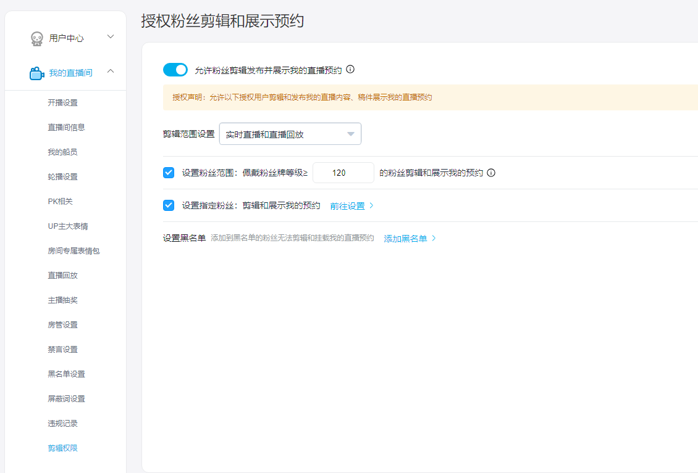

# BiliLiveReplayDL

GitHub is a global platform, and theoretically, everyone should use English. But since this project is mostly meant for Chinese user and rely on a Chinese website [BiliBili](https://www.bilibili.com) (*[wikipedia](https://en.wikipedia.org/wiki/Bilibili)*), most things related to this project like code comments, documentations and other related repositories are written in Chinese.

这是一个依赖于主播授权直播回放的实时直播剪辑权限的直播录制脚本，请确保主播能够授予你直播回放的实时直播剪辑权限。




## 项目结构总览

```
bilibili-recorder/
├── package.json
├── tsconfig.json
├── README.md
├── src/
│   ├── main.ts                      # 入口文件，初始化与主循环逻辑
│   ├── core/
│   │   ├── RecorderManager.ts       # 录制任务调度器，管理请求队列与任务状态
│   │   ├── Fetcher.ts               # 网络请求封装，支持错误重试与延时
│   │   ├── SegmentFetcher.ts        # 分片获取逻辑（含 6 次快速重试 + 请求队列策略）
│   │   ├── RoomInfo.ts              # 获取直播间基础信息 (roomid -> uid, title 等)
│   │   ├── SegmentMerger.ts         # TS -> MP4 合并工具，支持中断时间写入
│   │   └── Logger.ts                # 日志模块（控制台输出 + 文件记录）
│   │
│   ├── utils/
│   │   ├── time.ts                  # 时间格式化、延时、间隔工具
│   │   ├── queue.ts                 # 请求队列管理器（带指数退避、最大任务数）
│   │   ├── ffmpeg.ts                # FFmpeg 调用与参数封装
│   │   └── error.ts                 # 自定义错误类型定义
│   │
│   ├── config/
│   │   ├── index.ts                 # 全局配置（请求间隔、最大重试次数、输出目录）
│   │   └── constants.ts             # 各类常量定义
│   │
│   └── types/
│       ├── room.ts                  # 房间信息接口类型定义
│       ├── segment.ts               # 视频分片信息接口类型定义
│       └── recorder.ts              # Recorder 状态与任务定义
│
└── output/
    ├── logs/                        # 日志目录
    ├── temp/                        # 临时 ts 分片存储
    └── videos/                      # 最终合成 mp4 存储位置
```